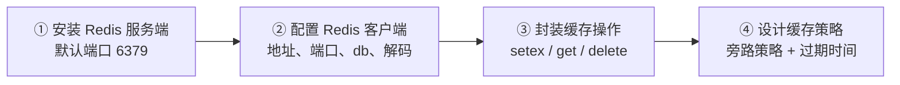

# FastAPI 第六章｜AI 掘金头条：缓存与调用模型

> **定位**：学完后用于快速复习、回忆核心概念、照着代码恢复手感，而不是逐页重读 PPT。  
> **资料依据**：《第六章_AI掘金头条-缓存和调用模型.pdf》（23 页，黑马程序员《FastAPI 基础到实战》），并参照配套代码 `toutiao_backend/`（`config/cache_conf.py`、`cache/news_cache.py`、`crud/news_cache.py`）。  
> **覆盖范围**：缓存的原理与优势、Redis 四步（装服务端 / 配客户端 / 封装操作 / 设计策略）、`setex`/`get`/`delete`/`exists`、旁路缓存策略、过期时间与缓存雪崩、新闻模块四类缓存 key、调用通义千问（Qwen）模型。  
> **阅读方法**：先看每节的「一句话记忆」，合上笔记说出原理，再看代码，最后做文末练习。

[TOC]

---

## 一、先建立整体认识

### 1. 为什么突然要加缓存

课件第 1 页抛了一个问题：

```text
用户 / 前端  →  FastAPI 服务器（业务逻辑控制中心）  →  数据库
1000 人同时查，数据库会怎样？
```

答案是：连接池被打满、查询排队、响应变慢，严重时直接挂掉。而新闻首页恰恰是**读多写少、同一批数据被反复查**的场景——完全没必要每次都去数据库。

### 2. 缓存是什么

课件原文：

> 缓存是一种存储机制，用于临时存储数据或计算结果，当再次需要这些数据时，可以快速从缓存中检索，而不是重新进行耗时或昂贵的获取和计算过程。

一张图记住三者的分工：

```text
用户 / 前端  →  FastAPI 服务器（业务逻辑：先问缓存）
                    ↘  Redis：高速临时数据（取得快）
                    ↘  数据库：权威真实数据（存得住）
```

| 角色 | 定位 | 特点 |
| --- | --- | --- |
| **Redis** | 高速临时数据 | 内存存储，读写极快，但可能丢（缓存可以重建） |
| **MySQL** | 权威真实数据 | 持久化，慢，但是唯一可信来源 |

**一句话记忆：缓存的本质是"用空间换时间"，数据库仍是唯一真相，缓存只是副本。**

### 3. 缓存的四大优势（课件第 2 页）

1. 提升性能和用户体验
2. 减轻服务器 / 数据库负载
3. 降低网络延迟
4. 节省资源和成本

### 4. 项目中的缓存流程（课件第 3 页）

```text
前端请求数据
   │
   ▼
服务器查缓存
   ├── 有缓存 ────────────────→ 返回数据给前端
   └── 无缓存
         → 查数据库
         → 写入缓存
         → 返回数据给前端
```

**这句话要背下来：先查缓存，没有就查库并回填。** 后面所有策略都是它的展开。

### 5. Redis 四步（全章骨架）

课件第 5 页：



---

## 二、安装 Redis 服务端

课件第 7 页：

| 平台 | 安装 | 验证 |
| --- | --- | --- |
| **Mac** | `brew install redis` | `redis-server` |
| **Windows** | 双击 `.msi` 文件安装 | `redis-cli ping`（返回 `PONG` 即成功） |

要点：

- 默认端口 **6379**，安装后需要**启动服务**（Windows 装成服务后开机自启，Mac 需手动 `redis-server`）。
- 本项目的 Redis 没有设密码，仅本地开发使用；生产环境必须设 `requirepass` 并限制访问来源。

**一句话记忆：Redis 是独立进程，不是 Python 包——装完还要"跑起来"才能连。**

---

## 三、配置 Redis 客户端

### 1. 安装客户端

```bash
pip install redis
```

> 项目 `requirements.txt` 里同时出现 `redis==7.1.0` 与 `aioredis==2.0.1`。**用 `redis` 包就够了**：`redis.asyncio` 已经内置异步支持，`aioredis` 已并入 `redis`，不必单独安装。

### 2. 连接对象

```python
import redis.asyncio as redis

redis_client = redis.Redis(
    host="localhost",      # Redis 服务器地址
    port=6379,             # 端口号
    db=0,                  # 数据库编号 0~15
    decode_responses=True  # 是否把返回的字节流解码为字符串
)
```

四个参数（课件第 9 页）：

| 参数 | 含义 | 不写会怎样 |
| --- | --- | --- |
| `host` | Redis 服务器地址 | 默认 127.0.0.1 |
| `port` | 端口号，默认 6379 | 端口不对就连接被拒 |
| `db` | 数据库编号（0~15），不同 db 互不干扰 | 默认 0 |
| `decode_responses` | `True` 时返回 `str`，`False` 返回 `bytes` | 拿到 `b'...'`，`json.loads` 会报错 |

**一句话记忆：`decode_responses=True` 是 Python 用 Redis 的第一道坑——不加就得处处 `.decode()`。**

### 3. 本项目的位置

```text
config/cache_conf.py     连接对象 + 基础操作封装（get_cache / set_cache）
cache/news_cache.py      业务缓存（键设计 + 分类/列表/详情/相关新闻）
crud/news_cache.py       带缓存的 CRUD（先查缓存 → 查库 → 回填）
```

---

## 四、封装缓存操作

### 1. 四个基础方法（课件第 11 页）

缓存操作就是围绕 Redis 做"存、取、删、判断"：

| 方法 | 参数 | 描述 |
| --- | --- | --- |
| `setex` | `key: str, expire: int(秒), value: str` | 设置缓存并指定过期时间 |
| `get` | `key: str` | 获取缓存值，不存在返回 `None` |
| `delete` | `key: str` | 删除指定缓存键 |
| `exists` | `key: str` | 检查键是否存在，返回布尔值 |

```python
await redis_client.setex("news:categories", 7200, "[]")   # 存 2 小时
value = await redis_client.get("news:categories")          # 取
await redis_client.delete("news:categories")               # 删
exists = await redis_client.exists("news:categories")      # 判断
```

### 2. 为什么用 `setex` 而不是 `set`

`set` 不过期，缓存会永远留在内存里，数据一变就永远是旧的。`setex`（set + expire）**天然自带"过期自动清理"**，这一条就解决了缓存最常见的两个问题：内存无限增长、数据陈旧。

### 3. 本项目封装了什么

Redis 只能存字符串，而业务要存**列表/字典**，所以封装里多做了一层 JSON：

```python
# config/cache_conf.py
import json

import redis.asyncio as redis

redis_client = redis.Redis(host="localhost", port=6379, db=0, decode_responses=True)


async def get_cache(key: str):
    """读取：字符串"""
    try:
        return await redis_client.get(key)
    except Exception as e:
        print(f"获取缓存失败：{e}")
        return None


async def get_json_cache(key: str):
    """读取：列表或字典"""
    try:
        data = await redis_client.get(key)
        if data:
            return json.loads(data)
        return None
    except Exception as e:
        print(f"获取 JSON 缓存失败：{e}")
        return None


async def set_cache(key: str, value, expire: int = 3600):
    """设置缓存 setex(key, expire, value)"""
    try:
        if isinstance(value, (dict, list)):
            value = json.dumps(value, ensure_ascii=False)   # 中文正常保存
        await redis_client.setex(key, expire, value)
        return True
    except Exception as e:
        print(f"设置缓存失败：{e}")
        return False
```

三个设计点：

| 设计 | 原因 |
| --- | --- |
| `json.dumps(..., ensure_ascii=False)` | 否则中文会变成 `\u4e2d\u6587`，缓存里没法看 |
| 读用 `json.loads`、写用 `json.dumps` | Redis 只认字符串，结构体要序列化 |
| 全部 `try/except` 且失败返回 `None`/`False` | **缓存挂了不能影响主流程**，这是缓存的容错原则 |

**一句话记忆：缓存是"加速器"不是"必需品"——Redis 报错时，代码要继续走查库那条路。**

---

## 五、旁路缓存策略（Cache-Aside）

### 1. 定义

课件原文：

> 旁路缓存策略（Cache-Aside）是一种常见的缓存策略，其核心概念是应用程序主动管理缓存，在读取数据时先检查缓存，如果缓存中没有数据，则从数据库或其他数据源加载数据，并将数据存入缓存；当数据更新或删除时，应用程序也负责更新或删除缓存中的数据。

课件第 12 页把它压成两句：

| 操作 | 规则 |
| --- | --- |
| **读** | 先查缓存，有数据则返回；没有则查数据库，并回填缓存 |
| **写** | 更新数据库后，**更新或删除**缓存 |

**一句话记忆：旁路 = 业务代码自己管缓存，读时回填、写时失效。**

### 2. 代码形态（课件第 13 页）

```python
async def get_categories(db: AsyncSession, skip: int = 0, limit: int = 100):
    # 1. 尝试从缓存获取
    cached_categories = await get_cached_categories()
    if cached_categories:
        return cached_categories

    # 2. 缓存没有 → 查数据库
    stmt = select(Category).offset(skip).limit(limit)
    result = await db.execute(stmt)
    categories = result.scalars().all()

    # 3. 回填缓存
    if categories:
        categories = jsonable_encoder(categories)
        await cache_categories(categories)

    return categories
```

这就是"读"路径的**标准三段式**：

```text
查缓存 → 命中就返回
      ↓ 未命中
    查数据库
      ↓
    写缓存（注意先转成可序列化结构）
      ↓
    返回
```

### 3. 写路径为什么建议"删缓存"而不是"改缓存"

| 做法 | 问题 |
| --- | --- |
| 写完顺便更新缓存 | 并发下两个请求的更新顺序可能反了，缓存留下旧值 |
| 写完**删除**缓存 | 下次读自然回填，简单且不容易错 |

课件写的是"更新或删除"，实践中**优先删除**。

### 4. 三种经典问题（补充）

| 问题 | 现象 | 常用对策 |
| --- | --- | --- |
| **缓存穿透** | 查一个根本不存在的 key，每次都打到数据库 | 缓存空值（短过期）或布隆过滤器 |
| **缓存击穿** | 热点 key 刚过期，瞬间大量请求打到数据库 | 互斥锁 / 逻辑过期 |
| **缓存雪崩** | 大批 key **同时**过期，数据库瞬时被打满 | 过期时间加随机抖动（见下一节） |

> 课件第 15 页特意强调"不同类型的数据，缓存时间不同，否则会出现缓存雪崩"——就是这一条。

---

## 六、过期时间设计

课件第 15 页的表：

| 类型 | 时间（秒） |
| --- | --- |
| 分类、配置 | 7200（2 小时） |
| 列表数据 | 600（10 分钟） |
| 详情数据 | 1800（30 分钟） |
| 验证码 | 120（2 分钟） |

**核心原则：数据越稳定，缓存越久；数据变化越快，缓存越短。**

| 数据 | 变化频率 | 过期时间定多久 |
| --- | --- | --- |
| 分类、配置 | 几乎不变 | 2 小时甚至更长 |
| 新闻列表 | 有新新闻就变 | 10 分钟 |
| 新闻详情 | 内容基本不变，浏览量在变 | 30 分钟 |
| 验证码 | 一次性 | 2 分钟 |

### 缓存雪崩的成因与对策

如果所有 key 都设成 7200 秒，那么上线 2 小时后它们会**同时过期**，所有请求同时打到数据库——这就是雪崩。

```python
import random

# 在基础过期时间上加一点随机抖动，错开过期时刻
expire = 7200 + random.randint(0, 600)
```

**一句话记忆：过期时间不要"整齐划一"，加随机抖动是成本最低的雪崩防护。**

---

## 七、新闻模块接入缓存

### 1. 四类缓存 key（课件第 17 页 + 项目代码）

| 数据 | Key 格式 | 过期 | 说明 |
| --- | --- | --- | --- |
| 新闻分类 | `news:categories` | 7200 | 全站一份 |
| 新闻列表 | `news_list:{分类id}:{页码}:{每页数量}` | 1800 | 每个分类每页一份 |
| 新闻详情 | `news:detail:{新闻id}` | 300 | 每条新闻一份 |
| 相关新闻 | `news:related:{新闻id}:{分类id}` | 1800 | 每条新闻一份 |

**Key 设计三原则：**

1. **唯一**：能把不同请求区分开（分类 + 页码 + 每页数量，缺一不可）
2. **可读**：用 `:` 分层，看到 key 就知道是什么数据
3. **可失效**：前缀统一，需要批量清理时可按 `news_list:*` 扫

```python
# cache/news_cache.py
CATEGORIES_KEY = "news:categories"
NEWS_LIST_PREFIX = "news_list:"
NEWS_DETAIL_PREFIX = "news:detail:"
RELATED_NEWS_PREFIX = "news:related:"


async def set_cache_news_list(category_id, page, size, news_list, expire=1800):
    category_part = category_id if category_id is not None else "all"
    key = f"{NEWS_LIST_PREFIX}{category_part}:{page}:{size}"
    return await set_cache(key, news_list, expire)


async def get_cache_news_list(category_id, page, size):
    category_part = category_id if category_id is not None else "all"
    key = f"{NEWS_LIST_PREFIX}{category_part}:{page}:{size}"
    return await get_json_cache(key)
```

> 注意 `category_id is None` 时用 `"all"` 占位——**key 里不能出现 `None`**，否则不同含义的请求会撞在一起。

### 2. 列表接入缓存：页码与 offset 的换算

分页接口原本用 `offset`，但缓存 key 更适合用"页码"。项目里做了换算：

```python
# skip = (页码 - 1) * 每页数量  →  页码 = skip // limit + 1
page = skip // limit + 1
cached_list = await get_cache_news_list(category_id, page, limit)
if cached_list:
    return [News(**item) for item in cached_list]      # 字典 → ORM 对象
```

```python
# 未命中：查库 + 回填
stmt = select(News).where(News.category_id == category_id).offset(skip).limit(limit)
news_list = (await db.execute(stmt)).scalars().all()

if news_list:
    news_data = [
        NewsItemBase.model_validate(item).model_dump(mode="json", by_alias=False)
        for item in news_list
    ]
    await set_cache_news_list(category_id, page, limit, news_data)

return news_list
```

**关键点：缓存里存的是"字典"，不是 ORM 对象。**

| 方向 | 转换 |
| --- | --- |
| 写缓存 | `NewsItemBase.model_validate(orm).model_dump(mode="json", by_alias=False)` |
| 读缓存 | `News(**dict)` 还原成 ORM 对象 |

为什么用 `by_alias=False`？因为缓存是**给后端自己用的**，保持数据库字段名（`publish_time`）比保持前端别名（`publishTime`）更稳——前端别名随时可能改，改了缓存就废了。

### 3. 详情与浏览量：一个需要想清楚的冲突

详情接口要做两件事：返回详情 + 浏览量 +1。但浏览量一变，详情缓存就"旧"了。

```python
news_detail = await news_cache.get_news_detail(db, news_id)
if not news_detail:
    raise HTTPException(status_code=404, detail="新闻不存在")

views_res = await news.increase_news_views(db, news_detail.id)
if not views_res:
    raise HTTPException(status_code=404, detail="新闻不存在")

related_news = await news_cache.get_related_news(db, news_detail.id, news_detail.category_id)
```

- **浏览量走数据库**（`update().values(views=News.views + 1)`），保证计数准确；
- **详情缓存 5 分钟**，所以响应里的 `views` 可能是缓存里的旧值。

这是缓存与"强一致"的取舍：**浏览量要求最终一致即可**，不必为了它每次打库。

### 4. 相关新闻：顺带缓存

```python
stmt = (
    select(News)
    .where(News.category_id == category_id, News.id != news_id)
    .order_by(News.views.desc(), News.publish_time.desc())
    .limit(limit)
)
```

相关新闻按"**浏览量优先、发布时间次之**"排序，这是全章唯一用到多字段排序的地方。

### 5. 上线缓存后的自测顺序

| 步骤 | 观察什么 |
| --- | --- |
| 打开分类接口 | 控制台第一次有 SQL，第二次没有 |
| `redis-cli keys *` | 出现 `news:categories`、`news_list:1:1:10` 等键 |
| `redis-cli ttl news:categories` | 返回剩余秒数，不是 `-1`（永不过期） |
| 改一次数据库里的分类名 | 缓存仍在，接口返回旧值 → 说明缓存生效 |
| `redis-cli del news:categories` | 再请求，值恢复最新 |

---

## 八、调用大模型（通义千问）

### 1. 课件讲的是什么

第 19–21 页：**大模型不是后端调的，而是前端直接调的**。

> 在前端页面中有模型请求的接口指定，支持千问（Qwen）系列模型的使用，可以直接指定对应的 API 和 key。

也就是说本项目后端只提供"新闻数据"，AI 问答由前端带着 Key 直接请求阿里云百炼。

### 2. 使用步骤（课件第 20 页）

```text
登录阿里云百炼模型广场
   → 选择模型（通义千问 3-Max）
   → API 参考
   → 获取 HTTP 请求地址 + API Key
   → 前端调用
```

### 3. 前端配置位置（课件第 21 页）

```text
前端项目 → src/ → config/ → api.js → 替换 大模型 HTTP 请求地址 + API Key + 模型
```

```javascript
export const apiConfig = {
  baseURL: 'http://127.0.0.1:8000',          // 自己的后端
}

export const aiChatConfig = {
  apiEndpoint: 'https://dashscope.aliyuncs.com/compatible-mode/v1/chat/completions',
  apiKey: '<在这里填你的 API Key>',
  model: 'qwen3-max-preview',
}
```

三行配置对应三件事：

| 配置项 | 作用 |
| --- | --- |
| `apiEndpoint` | 百炼的兼容 OpenAI 协议地址 |
| `apiKey` | 身份凭证，计费依据 |
| `model` | 指定用哪个模型 |

### 4. 两个必须提醒的点

**① Key 不能提交到仓库。** 课程物料里的 `api.js` 是明文写死的，一旦推到公开仓库就等于把额度送人。正确做法：

```javascript
apiKey: import.meta.env.VITE_DASHSCOPE_KEY,   // 放 .env.local，且 .env.local 进 .gitignore
```

**② 前端直连 = Key 暴露在浏览器。** 任何人打开 DevTools 都能看到。生产项目应当让**后端代理**：

```text
浏览器 → 自己的后端 /api/ai/chat → 后端带 Key 调百炼 → 返回结果
```

后端代理还能顺便做限流、鉴权、内容审核和用量统计。

**一句话记忆：课程为了省事让前端直连，真实项目把 Key 放后端。**

---

## 九、原课件练习题整理（建议先独立完成）

### 练习 1：说清缓存的价值（课件第 1、2 页）

用"1000 人同时查新闻列表"这个场景，说明不加缓存会发生什么、加了之后好在哪。

### 练习 2：装好 Redis 并连通（课件第 7 页）

在 Windows / Mac 上启动 Redis，用 `redis-cli ping` 验证，并用 Python 客户端写入、读出一个键。

### 练习 3：封装缓存三件套（课件第 11 页）

实现 `get_cache` / `set_cache` / `delete_cache`，要求：支持 dict/list、中文不乱码、异常不抛出。

### 练习 4：给分类接口加缓存（课件第 13 页）

按"查缓存 → 查库 → 回填"三段式改造 `get_categories`，过期时间 7200 秒。

### 练习 5：给新闻列表加缓存（课件第 17 页）

设计 key 为 `news_list:{分类id}:{页码}:{每页数量}`，过期 1800 秒，说明为什么要用 `by_alias=False`。

### 练习 6：设计过期时间（课件第 15 页）

给"分类、列表、详情、验证码"四类数据分别定过期时间，并说明理由；再说明缓存雪崩怎么防。

### 练习 7（思考题）

1. 为什么缓存操作要 `try/except` 并且失败返回 `None`？
2. 详情接口浏览量 +1 之后，缓存里的 `views` 是旧值，应该怎么处理？

---

## 十、练习参考答案

### 练习 1

不加缓存：1000 个请求全部打到 MySQL，连接池（`pool_size=10 + max_overflow=20`）最多 30 个连接，其余排队；`select` 全表扫描 + 排序，单次几十毫秒，用户端表现为转圈甚至超时。加缓存后：新闻列表 10 分钟内基本不变，第一个请求回填后，后续请求直接从内存读，响应从几十毫秒降到 1 毫秒级，数据库压力下降两三个数量级。

### 练习 2

```bash
# Windows
redis-cli ping        # 期望输出 PONG

# Mac
redis-server          # 前台启动，另开一个终端
redis-cli ping
```

```python
import asyncio
import redis.asyncio as redis

async def main():
    r = redis.Redis(host="localhost", port=6379, db=0, decode_responses=True)
    await r.setex("demo:key", 60, "hello redis")
    print(await r.get("demo:key"))     # hello redis
    print(await r.ttl("demo:key"))     # 约 60
    await r.delete("demo:key")
    await r.aclose()

asyncio.run(main())
```

### 练习 3

```python
import json
import redis.asyncio as redis

redis_client = redis.Redis(host="localhost", port=6379, db=0, decode_responses=True)


async def set_cache(key: str, value, expire: int = 3600) -> bool:
    try:
        if isinstance(value, (dict, list)):
            value = json.dumps(value, ensure_ascii=False)
        await redis_client.setex(key, expire, value)
        return True
    except Exception as e:
        print(f"设置缓存失败：{e}")
        return False


async def get_cache(key: str):
    try:
        data = await redis_client.get(key)
        if not data:
            return None
        try:
            return json.loads(data)      # 结构体
        except json.JSONDecodeError:
            return data                  # 普通字符串
    except Exception as e:
        print(f"获取缓存失败：{e}")
        return None


async def delete_cache(key: str) -> bool:
    try:
        return await redis_client.delete(key) > 0
    except Exception as e:
        print(f"删除缓存失败：{e}")
        return False
```

### 练习 4

```python
async def get_categories(db: AsyncSession, skip: int = 0, limit: int = 100):
    cached = await get_json_cache("news:categories")
    if cached:
        return cached

    stmt = select(Category).offset(skip).limit(limit)
    categories = (await db.execute(stmt)).scalars().all()

    if categories:
        data = jsonable_encoder(categories)
        await set_cache("news:categories", data, expire=7200)
        return data

    return categories
```

### 练习 5

```python
key = f"news_list:{category_id}:{page}:{size}"
cached = await get_json_cache(key)
if cached:
    return [News(**item) for item in cached]

stmt = select(News).where(News.category_id == category_id).offset(skip).limit(size)
news_list = (await db.execute(stmt)).scalars().all()

if news_list:
    data = [NewsItemBase.model_validate(n).model_dump(mode="json", by_alias=False)
            for n in news_list]
    await set_cache(key, data, expire=1800)
return news_list
```

用 `by_alias=False` 的原因：缓存是后端自产自用，保持数据库字段名（`publish_time`）与 ORM/模型一致；若存成前端别名（`publishTime`），以后前端改名就得清一次缓存，而且 `News(**item)` 还原时会因为字段名对不上而失败。

### 练习 6

| 类型 | 过期 | 理由 |
| --- | --- | --- |
| 分类、配置 | 7200 | 几乎不变，长缓存收益最大 |
| 列表 | 600 | 新新闻会进来，太长会"看不到新内容" |
| 详情 | 1800 | 内容基本稳定 |
| 验证码 | 120 | 一次性，且必须在 2 分钟内失效 |

防雪崩：**在固定过期时间上加随机抖动**（如 `7200 + random.randint(0, 600)`），让 key 分散过期；此外可加热点预热、多级缓存。

### 练习 7

1. 缓存是加速手段，Redis 挂掉/超时不应让接口直接 500。`try/except` + 返回 `None` 让代码自动降级到"查数据库"，用户最多感觉慢一点而不是打不开。
2. 三种处理：① 接受最终一致（本项目做法，5 分钟后自然刷新）；② 自增后 `delete` 该详情缓存，让下次请求重建；③ 缓存里只存不常变的字段（标题、正文），`views` 每次都从数据库读。浏览量场景推荐 ① 或 ③。

---

## 十一、最容易混淆的知识点

| 容易混淆 | 正确认识 |
| --- | --- |
| `set` 与 `setex` | 后者带过期时间，缓存必须用它，否则数据永远不更新 |
| `decode_responses` | 不设就是 `bytes`，`json.loads` 会直接报错 |
| 缓存里存什么 | 存 JSON 字符串（dict/list），**不能存 ORM 对象** |
| `json.dumps` 的 `ensure_ascii` | `False` 才能正常显示中文 |
| Key 的唯一性 | 分类 + 页码 + 每页数量缺一不可，否则不同请求互相覆盖 |
| `by_alias=True/False` | 缓存内部用 `False`（数据库字段名）；响应给前端用 `True`（驼峰） |
| offset 与 page | 换算公式 `page = skip // limit + 1`，`skip = (page-1)*limit` |
| 缓存与浏览量 | 详情缓存会让 `views` 短暂偏旧，属可接受最终一致 |
| 缓存异常 | 必须吞掉并降级查库，不能影响主流程 |
| 缓存雪崩 | 大批 key 同时过期；用随机抖动错开 |
| `redis` 与 `aioredis` | `redis.asyncio` 已内置，不必单独装 `aioredis` |
| 大模型 Key 的位置 | 课程放前端便于演示；真实项目必须放后端代理 |

### 课件示例与项目代码的整理说明

1. **`news_list` 的 key 前缀**：课件写 `news:list:分类ID:页码:每页数量`，项目代码用 `news_list:`。两者都可以，本笔记以项目代码为准并注明课件写法。
2. **列表缓存过期时间**：课件表格是 600 秒（10 分钟），项目代码 `set_cache_news_list` 默认 1800 秒。以实际代码为准，理解"列表比分类短"即可。
3. **详情缓存时间**：课件表格是 1800 秒，项目 `cache_news_detail` 默认 300 秒（5 分钟），更保守，能减少浏览量偏差。
4. **`api.js` 里的明文 API Key**：课程物料直接写死，本笔记不抄录具体 Key，并给出 `import.meta.env` 与后端代理两种正确做法。
5. **`requirements.txt` 同时有 `redis` 与 `aioredis`**：`aioredis` 已并入 `redis`，只装 `redis` 即可。

以上属于**版本与一致性修正**，不改变原课件知识点。

---

## 十二、闭卷自测：10 分钟检验掌握情况

1. 缓存解决什么问题？它和数据库的分工是什么？
2. 说说"先查缓存、未命中查库、回填缓存"的完整流程。
3. Redis 四步分别是什么？
4. `setex` 的三个参数是什么？为什么不用 `set`？
5. `decode_responses=True` 不加会怎样？
6. 为什么缓存里不能直接存 ORM 对象？存的时候做了什么转换？
7. 什么是旁路缓存策略？读和写各自的规则？
8. 写操作为什么倾向于"删缓存"而不是"改缓存"？
9. 四类新闻缓存的 key 分别怎么设计？过期时间大概多少？
10. 什么是缓存雪崩？怎么防？
11. 为什么缓存操作必须 `try/except`？
12. 大模型在本项目里是谁调用的？为什么真实项目不该这么做？

**达标标准**：能不看笔记写出"连接 + 封装 + 给分类/列表加缓存"，并用 `redis-cli` 验证缓存命中与过期。

**参考答案**（先自己回答，再对照）：

1. 减少数据库压力、降低延迟；Redis 存副本求快，MySQL 是唯一可信来源。  
2. 查缓存 → 命中直接返回 → 未命中查库 → 序列化后 `setex` 回填 → 返回。  
3. 安装服务端（6379）→ 配置客户端（host/port/db/decode）→ 封装操作（setex/get/delete）→ 设计策略（旁路 + 过期）。  
4. `key`、`expire`（秒）、`value`；`set` 不过期，数据会永远陈旧、内存无限增长。  
5. 返回值是 `bytes`，`json.loads` 报 `TypeError`，打印出来是 `b'...'`。  
6. ORM 对象带会话状态、连接等内部结构，无法 JSON 序列化；用 `model_dump(mode="json")` 转成字典再 `json.dumps`。  
7. 应用自己管理缓存；读：先缓存后库并回填；写：更新库后更新或删除缓存。  
8. 并发下"改缓存"可能把旧值写回去；"删缓存"下次读自然重建，简单可靠。  
9. `news:categories`（7200）、`news_list:{cid}:{page}:{size}`（600~1800）、`news:detail:{id}`（300~1800）、`news:related:{id}:{cid}`（1800）。  
10. 大批 key 同时过期导致数据库瞬时被打满；用随机抖动错开过期时间。  
11. 缓存是加速器不是必需品，Redis 故障时要自动降级到查库。  
12. 由前端直接调阿里云百炼；真实项目 Key 会暴露在浏览器，应改为后端代理并做限流与鉴权。

---

## 十三、一页速查

### 安装与验证

```bash
pip install redis
redis-cli ping        # PONG 表示服务端已启动
```

### 连接与封装

```python
import json
import redis.asyncio as redis

redis_client = redis.Redis(host="localhost", port=6379, db=0, decode_responses=True)


async def set_cache(key: str, value, expire: int = 3600):
    try:
        if isinstance(value, (dict, list)):
            value = json.dumps(value, ensure_ascii=False)
        await redis_client.setex(key, expire, value)
        return True
    except Exception as e:
        print(f"设置缓存失败：{e}")
        return False


async def get_json_cache(key: str):
    try:
        data = await redis_client.get(key)
        return json.loads(data) if data else None
    except Exception as e:
        print(f"获取缓存失败：{e}")
        return None
```

### 旁路缓存模板

```python
async def get_news_list_cached(db, category_id, page, size):
    key = f"news_list:{category_id}:{page}:{size}"

    cached = await get_json_cache(key)
    if cached:
        return [News(**item) for item in cached]

    offset = (page - 1) * size
    stmt = select(News).where(News.category_id == category_id).offset(offset).limit(size)
    news_list = (await db.execute(stmt)).scalars().all()

    if news_list:
        data = [NewsItemBase.model_validate(n).model_dump(mode="json", by_alias=False)
                for n in news_list]
        await set_cache(key, data, expire=1800)

    return news_list
```

### 四个基础命令

| 命令 | 用法 |
| --- | --- |
| `setex(key, expire, value)` | 存 + 设过期 |
| `get(key)` | 取，不存在返回 `None` |
| `delete(key)` | 删 |
| `exists(key)` | 判存在 |

### 过期时间参考

| 类型 | 秒 | 说明 |
| --- | --- | --- |
| 分类 / 配置 | 7200 | 几乎不变 |
| 列表 | 600 | 会进新内容 |
| 详情 | 300~1800 | 内容稳定 |
| 验证码 | 120 | 一次性 |

### 核心知识结构

```text
缓存与模型调用
├── 为什么缓存
│   └── 读多写少、减轻数据库压力、降低延迟
├── Redis 四步
│   ├── ① 装服务端（6379）
│   ├── ② 配客户端（redis.asyncio, decode_responses=True）
│   ├── ③ 封装操作（setex / get / delete / exists + json）
│   └── ④ 设计策略（旁路 + 过期时间）
├── 旁路策略
│   ├── 读：缓存 → 库 → 回填
│   └── 写：更新库 → 删缓存
├── 新闻模块缓存
│   ├── news:categories                 7200
│   ├── news_list:{cid}:{page}:{size}   600~1800
│   ├── news:detail:{id}                300~1800
│   └── news:related:{id}:{cid}         1800
└── 大模型
    ├── 百炼 → Qwen3-Max → endpoint + key + model
    └── 课程：前端直连；生产：后端代理
```

### 复习顺序建议

- **第 1 遍（理解）**：看一、五节，把"先查缓存、未命中查库回填"说顺。
- **第 2 遍（动手）**：装 Redis，写 `cache_conf.py`，给分类接口加缓存。
- **第 3 遍（扩展）**：给列表、详情、相关新闻都加上，观察命中率。
- **以后快速回顾**：优先看第五、六、七、十一节。

> **本章边界**：课件围绕 Redis 缓存与前端调用大模型，**没有**讲解缓存穿透/击穿的完整工程方案、分布式锁、多级缓存（本地 + Redis）、Redis 持久化（RDB/AOF）、集群与哨兵、缓存预热与降级熔断，也没有讲后端如何封装大模型调用（流式响应 `StreamingResponse`、对话上下文管理、Token 计数与限流）。这些内容后续单独整理，不要与本章混在一起。
