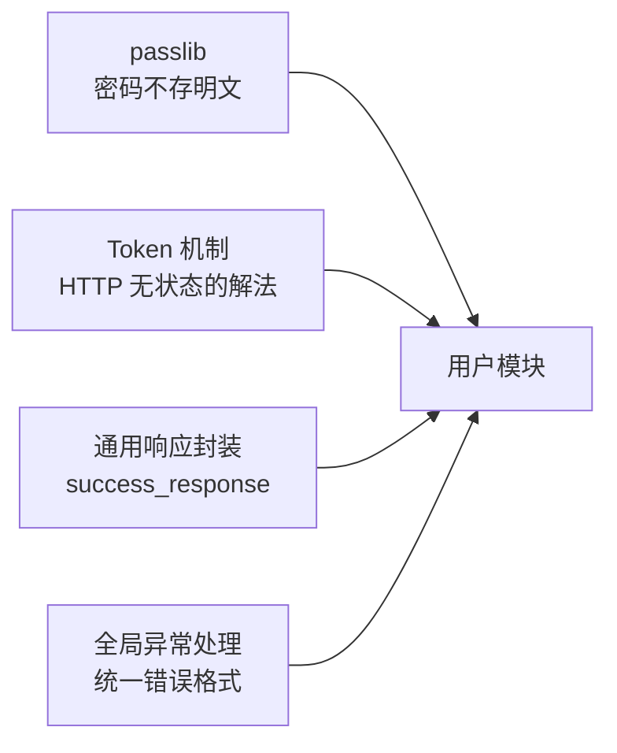

# FastAPI 第四章｜AI 掘金头条：用户模块

> **定位**：学完后用于快速复习、回忆核心概念、照着代码恢复手感，而不是逐页重读 PPT。  
> **资料依据**：《第四章_AI掘金头条-用户模块.pdf》（30 页，黑马程序员《FastAPI 基础到实战》），并参照配套代码 `toutiao_backend/`、`database.sql` 与《API 接口规范文档》。  
> **覆盖范围**：用户表与令牌表、passlib 密码加密、Token 机制、通用成功响应封装、全局异常处理器、注册/登录/查信息/改信息/改密码五个接口、`get_current_user` 依赖项。  
> **阅读方法**：先看每节的「一句话记忆」，合上笔记说出原理，再看代码，最后做文末练习。

[TOC]

---

## 一、先建立整体认识

### 1. 用户模块在整个项目里的位置

前两章把"新闻能看"做完了，这一章解决"**你是谁**"的问题。因为后面的收藏、浏览历史都必须知道"这条记录属于谁"。

本章要交付的 5 个接口（对照接口规范文档）：

| 接口 | 方法 | 说明 | 需要登录 |
| --- | --- | --- | --- |
| `/api/user/register` | POST | 用户注册 | 否 |
| `/api/user/login` | POST | 用户登录 | 否 |
| `/api/user/info` | GET | 获取用户信息 | ✅ |
| `/api/user/update` | PUT | 更新用户信息 | ✅ |
| `/api/user/password` | PUT | 修改密码 | ✅ |

**一句话记忆：注册和登录负责"发证"，其余三个接口都要先"验证"——所以本章一半是业务，一半是认证。**

### 2. 本章新增的四样东西

前三章的写法在这里不够用了，课件补了四个基础设施：



| 新增 | 解决什么问题 |
| --- | --- |
| **passlib 加密** | 数据库里不能存明文密码 |
| **Token** | HTTP 是无状态的，登录状态要靠"证"携带 |
| **通用响应格式** | 每个接口都手写 `{"code":200,...}` 太重复 |
| **全局异常处理器** | 异常一旦漏出去，前端拿到的结构和其他接口不一致 |

### 3. 四步法在用户模块的落点

| 步骤 | 用户模块的具体内容 |
| --- | --- |
| ① 模块化路由 | `APIRouter(prefix="/api/user", tags=["users"])` |
| ② 定义模型类 | `User`、`UserToken`（参照 `user`、`user_token` 两张表） |
| ③ 数据库 CRUD | `crud/users.py`：查用户、建用户、建令牌、按令牌查用户、更新、改密 |
| ④ 路由调用逻辑 | `routers/users.py`：注入 `db` 与 `get_current_user`，拼响应 |

---

## 二、两张表与对应模型类

### 1. 表结构

**`user`（用户表）** —— 来自 `database.sql`：

| 字段 | 类型 | 说明 |
| --- | --- | --- |
| `id` | INT PK | 用户 ID |
| `username` | VARCHAR(50) UNIQUE | 用户名 |
| `password` | VARCHAR(255) | **加密后**的密码 |
| `nickname` | VARCHAR(50) | 昵称 |
| `avatar` | VARCHAR(255) | 头像 URL |
| `gender` | ENUM(male/female/unknown) | 性别 |
| `bio` | VARCHAR(500) | 个人简介 |
| `phone` | VARCHAR(20) UNIQUE | 手机号 |
| `created_at` / `updated_at` | TIMESTAMP | 创建/更新时间 |

**`user_token`（用户令牌表）**：

| 字段 | 类型 | 说明 |
| --- | --- | --- |
| `id` | INT PK | 令牌 ID |
| `user_id` | INT FK → `user.id` | 所属用户 |
| `token` | VARCHAR(255) UNIQUE | 令牌值（UUID） |
| `expires_at` | TIMESTAMP | 过期时间 |
| `created_at` | TIMESTAMP | 创建时间 |

**一句话记忆：密码列只有 255 长度，因为存的是 bcrypt 密文（60 字符左右），不是明文。**

### 2. 模型类

```python
from datetime import datetime
from typing import Optional

from sqlalchemy import Index, Integer, String, Enum, DateTime, ForeignKey
from sqlalchemy.orm import DeclarativeBase, Mapped, mapped_column


class Base(DeclarativeBase):
    pass


class User(Base):
    __tablename__ = "user"

    __table_args__ = (
        Index("username_UNIQUE", "username"),
        Index("phone_UNIQUE", "phone"),
    )

    id: Mapped[int] = mapped_column(Integer, primary_key=True, autoincrement=True, comment="用户ID")
    username: Mapped[str] = mapped_column(String(50), unique=True, nullable=False, comment="用户名")
    password: Mapped[str] = mapped_column(String(255), nullable=False, comment="密码（加密存储）")
    nickname: Mapped[Optional[str]] = mapped_column(String(50), comment="昵称")
    avatar: Mapped[Optional[str]] = mapped_column(
        String(255), comment="头像URL",
        default="https://fastly.jsdelivr.net/npm/@vant/assets/cat.jpeg")
    gender: Mapped[Optional[str]] = mapped_column(
        Enum("male", "female", "unknown"), comment="性别", default="unknown")
    bio: Mapped[Optional[str]] = mapped_column(
        String(500), comment="个人简介", default="这个人很懒，什么都没留下")
    phone: Mapped[Optional[str]] = mapped_column(String(20), unique=True, comment="手机号")
    created_at: Mapped[datetime] = mapped_column(DateTime, default=datetime.now, comment="创建时间")
    updated_at: Mapped[datetime] = mapped_column(
        DateTime, default=datetime.now, onupdate=datetime.now, comment="更新时间")


class UserToken(Base):
    __tablename__ = "user_token"

    __table_args__ = (
        Index("token_UNIQUE", "token"),
        Index("fk_user_token_user_idx", "user_id"),
    )

    id: Mapped[int] = mapped_column(Integer, primary_key=True, autoincrement=True, comment="令牌ID")
    user_id: Mapped[int] = mapped_column(Integer, ForeignKey(User.id), nullable=False, comment="用户ID")
    token: Mapped[str] = mapped_column(String(255), unique=True, nullable=False, comment="令牌值")
    expires_at: Mapped[datetime] = mapped_column(DateTime, nullable=False, comment="过期时间")
    created_at: Mapped[datetime] = mapped_column(DateTime, default=datetime.now, comment="创建时间")
```

两个细节：

- `avatar` / `bio` / `gender` 都给了默认值，所以注册时**只需要传用户名和密码**。
- `UserToken.user_id` 是外键，一个用户只保留**一条**当前令牌（`create_token` 里"有则更新、无则新增"）。

---

## 三、密码加密：passlib

### 1. 为什么不能存明文

数据库一旦泄露，明文密码等于把用户在其他网站的账号一起送出去。所以注册时就加密，登录时只做"**用同样算法验一遍**"。

### 2. 三步

| 步骤 | 内容 |
| --- | --- |
| ① 安装 | `pip install "passlib[bcrypt]==1.7.4"` |
| ② 创建加密上下文 | `pwd_context = CryptContext(schemes=["bcrypt"], deprecated="auto")` |
| ③ 加密或校验 | `pwd_context.hash(password)` / `pwd_context.verify(明文, 密文)` |

```python
# utils/security.py
from passlib.context import CryptContext

pwd_context = CryptContext(schemes=["bcrypt"], deprecated="auto")


def get_hash_password(password: str):
    return pwd_context.hash(password)


def verify_password(plain_password, hashed_password):
    return pwd_context.verify(plain_password, hashed_password)
```

**一句话记忆：`hash()` 是单向的，永远解不回来；`verify()` 才是"对答案"的正确姿势。**

### 3. 两个坑

- **`bcrypt` 必须锁 3.2.2**。`bcrypt>=4` 与 `passlib 1.7.4` 不兼容，启动时会报 `AttributeError: module 'bcrypt' has no attribute '__about__'`。项目 `requirements.txt` 里写的就是 `bcrypt==3.2.2`。
- **不要用 `==` 比密文**。bcrypt 每次 `hash` 都会加随机盐，同一个密码两次加密结果不同，只能 `verify`。

---

## 四、Token 机制

### 1. 什么是 Token

课件原文：

> Token 是服务器发给客户端的一段字符串，用来在后续请求中证明"你已经登录过了"。  
> 作用：解决 HTTP 是无状态的问题，在每次请求中"自我证明身份"。

流程：

```text
登录或注册 → 后端生成 Token → 后端返回 Token → 前端保存 Token
     → 每次请求时携带 Token → 后端验证 Token
```

**一句话记忆：HTTP 记不住谁是谁，所以每次都要带一张"通行证"。**

### 2. Token 放在哪

**请求头**，格式固定：

```http
Authorization: Bearer <token>
```

| 部分 | 含义 |
| --- | --- |
| `Authorization` | 专门用来放身份信息的请求头 |
| `Bearer` | 表示"持有者令牌" |
| `<token>` | 真正的身份凭证 |

### 3. 生成：uuid + 过期时间

```python
token = str(uuid.uuid4())                          # 随机字符串
expires_at = datetime.now() + timedelta(days=7)    # 7 天后过期
```

生成后要落库到 `user_token`，且**一个用户只留一条**：

```python
query = select(UserToken).where(UserToken.user_id == user_id)
user_token = (await db.execute(query)).scalar_one_or_none()

if user_token:                    # 已有：更新（相当于让旧 token 立即失效）
    user_token.token = token
    user_token.expires_at = expires_at
else:                             # 没有：新增
    db.add(UserToken(user_id=user_id, token=token, expires_at=expires_at))
    await db.commit()
```

> 这样设计的好处：**同一账号重新登录，旧令牌自动作废**，不用额外写"踢下线"逻辑。

### 4. 验证：取头 → 拆 Bearer → 查库 → 判过期

```python
# utils/auth.py
from fastapi import Header, Depends, HTTPException
from sqlalchemy.ext.asyncio import AsyncSession
from starlette import status

from config.db_conf import get_db
from crud import users


async def get_current_user(
        authorization: str = Header(..., alias="Authorization"),
        db: AsyncSession = Depends(get_db)
):
    # 请求头形如：Bearer xxxxx
    token = authorization.replace("Bearer ", "")
    user = await users.get_user_by_token(db, token)
    if not user:
        raise HTTPException(
            status_code=status.HTTP_401_UNAUTHORIZED,
            detail="无效的令牌或已经过期的令牌"
        )
    return user
```

**这是本章最值钱的一个函数**：它把一个"取头 + 查令牌 + 查用户 + 判过期"的流程，压缩成了一个依赖项。后面所有要登录的接口，只要写 `user: User = Depends(get_current_user)`。

`get_user_by_token` 的判定条件：

```python
if not db_token or db_token.expires_at < datetime.now():
    return None
```

**一句话记忆：`get_current_user` 是认证的唯一入口，写在 `utils/auth.py`，路由里只管 `Depends`。**

---

## 五、封装通用成功响应

### 1. 问题：每个接口都在手写同一套字典

```python
return {"code": 200, "message": "注册成功", "data": {...}}
```

写十次就有十次出错的机会，而且 `data` 里塞 ORM 对象时还会报"不可序列化"。

### 2. 三步封装

| 步骤 | 文件 | 内容 |
| --- | --- | --- |
| ① 抽取响应结果 | `utils/response.py` | `success_response(message, data)` |
| ② 定义数据类型 | `schemas/users.py` | `UserAuthResponse` + `UserInfoResponse` |
| ③ 调用函数响应 | `routers/users.py` | `success_response(message=..., data=response_data)` |

```python
# utils/response.py
from fastapi.responses import JSONResponse
from fastapi.encoders import jsonable_encoder


def success_response(message: str = "success", data=None):
    content = {"code": 200, "message": message, "data": data}

    # 把任何 FastAPI、Pydantic、ORM 对象转换成可以被 JSON 安全序列化的数据结构
    return JSONResponse(content=jsonable_encoder(content))
```

`jsonable_encoder` 是关键：`datetime`、`Decimal`、ORM 对象、Pydantic 模型，它都能转成基本类型。

### 3. 响应模型：别名与 `from_attributes`

```python
# schemas/users.py
class UserInfoBase(BaseModel):
    nickname: Optional[str] = Field(None, max_length=50, description="昵称")
    avatar: Optional[str] = Field(None, max_length=255, description="头像URL")
    gender: Optional[str] = Field(None, max_length=10, description="性别")
    bio: Optional[str] = Field(None, max_length=500, description="个人简介")


class UserInfoResponse(UserInfoBase):
    id: int
    username: str

    model_config = ConfigDict(
        from_attributes=True      # 允许直接从 ORM 对象属性取值
    )


class UserAuthResponse(BaseModel):
    token: str
    user_info: UserInfoResponse = Field(..., alias="userInfo")   # 输出 JSON 里叫 userInfo

    model_config = ConfigDict(
        populate_by_name=True,    # 用字段名 user_info 也能赋值
        from_attributes=True
    )
```

两个 `ConfigDict` 选项的区别：

| 选项 | 作用 | 少写会怎样 |
| --- | --- | --- |
| `from_attributes=True` | 允许 `model_validate(orm_obj)` 从对象属性取值 | 传 ORM 对象直接报校验错 |
| `populate_by_name=True` | 构造时既认 `user_info` 也认 `userInfo` | 只能按 alias 传，写 `user_info=` 会报缺少字段 |

### 4. 使用

```python
response_data = UserAuthResponse(
    token=token,
    user_info=UserInfoResponse.model_validate(user)
)
return success_response(message="注册成功", data=response_data)
```

**一句话记忆：函数管"外壳"（code/message/data），Pydantic 管"里子"（字段与别名）。**

---

## 六、全局异常处理器

### 1. 为什么需要

课件原文：

> 全局异常处理器是注册在 FastAPI 应用级别的异常处理函数，用于捕获业务层、数据库层以及系统层抛出的异常，并以统一的响应格式返回给前端。

不加的话，数据库报错会返回一大段 HTML/JSON 混合体，前端解析不了；而正常接口返回的是 `{code, message, data}`，两边结构不一致。

常见异常：

- SQL 错误
- 外键关联失败
- 数据库连接异常
- 提交事务失败
- ……

### 2. 两步

| 步骤 | 内容 |
| --- | --- |
| ① 定义异常处理器（函数） | 每类异常一个 `async def handler(request, exc)` |
| ② 全局注册 | `app.add_exception_handler(异常类, 异常处理函数名)` |

```python
# utils/exception_handlers.py
from fastapi import HTTPException
from sqlalchemy.exc import IntegrityError, SQLAlchemyError

from utils.exception import (
    http_exception_handler, integrity_error_handler,
    sqlalchemy_error_handler, general_exception_handler,
)


def register_exception_handlers(app):
    """注册全局异常处理：子类在前，父类在后；具体在前，抽象在后"""
    app.add_exception_handler(HTTPException, http_exception_handler)        # 业务
    app.add_exception_handler(IntegrityError, integrity_error_handler)      # 数据完整性约束
    app.add_exception_handler(SQLAlchemyError, sqlalchemy_error_handler)    # 数据库
    app.add_exception_handler(Exception, general_exception_handler)         # 兜底
```

### 3. 注册顺序为什么这么排

```text
HTTPException      →  业务主动抛的（404、401、400）
IntegrityError     →  SQLAlchemyError 的子类，更具体，必须先匹配
SQLAlchemyError    →  数据库层父类
Exception          →  一切兜底
```

**一句话记忆：子类在前、父类在后；具体在前、抽象在后。** 顺序反了，`IntegrityError` 会被 `SQLAlchemyError` 提前吃掉，就再也返回不了"用户名已存在"这种友好提示。

### 4. 一个处理器的样子

```python
async def integrity_error_handler(request: Request, exc: IntegrityError):
    error_msg = str(exc.orig)

    if "username_UNIQUE" in error_msg or "Duplicate entry" in error_msg:
        detail = "用户名已存在"
    elif "FOREIGN KEY" in error_msg:
        detail = "关联数据不存在"
    else:
        detail = "数据约束冲突，请检查输入"

    error_data = None
    if DEBUG_MODE:     # 开发模式返回详细信息，生产关掉
        error_data = {"error_type": "IntegrityError",
                      "error_detail": error_msg,
                      "path": str(request.url)}

    return JSONResponse(
        status_code=status.HTTP_400_BAD_REQUEST,
        content={"code": 400, "message": detail, "data": error_data},
    )
```

> ⚠️ `DEBUG_MODE` 开启时会把 SQL 报错原文和 `traceback` 返回给前端，**上线前必须关掉**，否则等于把表结构泄露给攻击者。

---

## 七、用户注册

### 1. 流程图（课件第 4、5 页）

```text
POST /api/user/register
  │  参数：username、password（Pydantic 校验）
  ▼
select().where(User.username == username)     ← 检查用户是否存在
  ├── 存在 → 抛出异常（用户已存在）
  └── 不存在
        ▼
   ① 密码加密（passlib bcrypt）
   ② add() 添加数据
        ▼
   uuid 生成临时 Token（str(uuid.uuid4())）→ 写入 user_token
        ▼
   返回 { code, message, data: { token, userInfo } }
```

### 2. 路由

```python
@router.post("/register")
async def register(user_data: UserRequest, db: AsyncSession = Depends(get_db)):
    # 1. 验证用户是否存在
    existing_user = await users.get_user_by_username(db, user_data.username)
    if existing_user:
        raise HTTPException(status_code=status.HTTP_400_BAD_REQUEST, detail="用户已存在")

    # 2. 创建用户（内部做密码加密）
    user = await users.create_user(db, user_data)

    # 3. 生成 Token
    token = await users.create_token(db, user.id)

    # 4. 响应
    response_data = UserAuthResponse(token=token, user_info=UserInfoResponse.model_validate(user))
    return success_response(message="注册成功", data=response_data)
```

### 3. CRUD

```python
async def create_user(db: AsyncSession, user_data: UserRequest):
    # 先密码加密处理 → add
    hashed_password = security.get_hash_password(user_data.password)
    user = User(username=user_data.username, password=hashed_password)
    db.add(user)
    await db.commit()
    await db.refresh(user)      # 从数据库读回最新的 user（拿到自增 id）
    return user
```

**`await db.refresh(user)` 不能省**：`commit` 后需要 `user.id` 去生成 Token，`refresh` 保证拿到数据库里的真实值（自增主键、默认值）。

---

## 八、用户登录

### 1. 流程图（课件第 12、13 页）

```text
POST /api/user/login
  │  参数：username、password
  ▼
检查用户是否存在
  ├── 不存在 → 返回 None → 401
  └── 存在
        ▼
   CryptContext.verify(明文, 密文)
        ├── 不一致 → 返回 None → 401
        └── 一致
              ▼
         生成访问令牌（复用 create_token，7 天有效）
              ▼
         返回 { token, userInfo }
```

### 2. 代码

```python
@router.post("/login")
async def login(user_data: UserRequest, db: AsyncSession = Depends(get_db)):
    user = await users.authenticate_user(db, user_data.username, user_data.password)
    if not user:
        raise HTTPException(status_code=status.HTTP_401_UNAUTHORIZED, detail="用户名或密码错误")
    token = await users.create_token(db, user.id)
    response_data = UserAuthResponse(token=token, user_info=UserInfoResponse.model_validate(user))
    return success_response(message="登录成功", data=response_data)
```

```python
async def authenticate_user(db: AsyncSession, username: str, password: str):
    user = await get_user_by_username(db, username)
    if not user:
        return None
    if not security.verify_password(password, user.password):
        return None
    return user
```

### 3. 一个安全细节

**"用户不存在"和"密码错误"返回同一句提示**（"用户名或密码错误"）。如果分开提示，攻击者就能先用接口探测哪些用户名已被注册。

---

## 九、获取用户信息（第一个需要登录的接口）

### 1. 流程图（课件第 15、16 页）

```text
GET /api/user/info
  │  Header: Authorization: Bearer xxx
  ▼
检查令牌有效性
  ├── 无令牌 / 已过期 → 抛出 401
  └── 有效
        ▼
   查找对应用户（select().where(UserToken.token == token) → 再查 User）
        ▼
   返回用户信息（不含 password）
```

### 2. 代码

```python
@router.get("/info")
async def get_user_info(user: User = Depends(get_current_user)):
    return success_response(
        message="获取用户信息成功",
        data=UserInfoResponse.model_validate(user)
    )
```

三行代码，因为认证、查库都已经被 `get_current_user` 吃掉了。

### 3. `Header` 参数

课件第 17 页：

> `Header` 用来从 HTTP 请求头中获取数据，是 FastAPI 提供的参数依赖工具。

```python
from fastapi import Header

@app.get("/info")
async def get_token(authorization: str = Header(...)):
    pass
```

| 写法 | 含义 |
| --- | --- |
| `Header(...)` | 必填，缺失直接 422 |
| `Header(None)` | 可选，缺失就是 `None` |
| `alias="Authorization"` | 请求头名大小写敏感时的显式写法（课程代码采用） |

**`UserInfoResponse` 里没有 `password` 字段**，所以响应天然不会泄露密码——这也是用 Pydantic 响应模型而不是直接 `return user` 的意义。

---

## 十、修改用户信息

### 1. 流程图（课件第 19、20 页）

```text
PUT /api/user/update
  │  Header: Token   参数：昵称、头像、性别、简介、手机号
  ▼
认证 Token → 成功 → 更新用户信息（update） → 响应更新后的用户
              └ 失败 → 401
```

### 2. 代码

```python
@router.put("/update")
async def update_user_info(
        user_data: UserUpdateRequest,
        user: User = Depends(get_current_user),
        db: AsyncSession = Depends(get_db)):
    user = await users.update_user(db, user.username, user_data)
    return success_response(message="更新用户信息成功", data=UserInfoResponse.model_validate(user))
```

```python
async def update_user(db: AsyncSession, username: str, user_data: UserUpdateRequest):
    query = update(User).where(User.username == username).values(
        **user_data.model_dump(exclude_unset=True, exclude_none=True)
    )
    result = await db.execute(query)
    await db.commit()

    if result.rowcount == 0:
        raise HTTPException(status_code=404, detail="用户不存在")

    return await get_user_by_username(db, username)   # 拿更新后的数据返回
```

### 3. 三个必须理解的点

**① `exclude_unset=True, exclude_none=True`**

```text
前端只传 {"bio": "新简介"}
  → model_dump 后只剩 {"bio": "新简介"}
  → 不会把 nickname / avatar 覆盖成 None
```

**少写这两个参数，用户改个签名会把昵称头像一起清空。**

**② `rowcount == 0`**

更新语句不报错不代表更新成功——如果 id 不存在，`rowcount` 就是 0，应当 404。

**③ 为什么最后要再查一次**

`update()` 是直接发 SQL，当前会话里那个 `user` 对象**不会自动更新**。所以要么 `refresh`，要么重新查一次。

---

## 十一、修改密码

### 1. 流程图（课件第 22、23 页）

```text
PUT /api/user/password
  │  Header: Token   参数：旧密码、新密码
  ▼
验证用户是否登录
  ├── 未登录 → 401
  └── 已登录
        ▼
   verify(旧密码, 数据库密文)
        ├── 不一致 → 返回 False → 抛异常
        └── 一致
              ▼
         新密码转密文 → 更新密码 → 响应结果
```

### 2. 代码

```python
@router.put("/password")
async def update_password(
        password_data: UserChangePasswordRequest,
        user: User = Depends(get_current_user),
        db: AsyncSession = Depends(get_db)):
    res = await users.change_password(
        db, user, password_data.old_password, password_data.new_password)
    if not res:
        raise HTTPException(status_code=500, detail="修改密码失败，请稍后再试")
    return success_response(message="修改密码成功")
```

```python
async def change_password(db: AsyncSession, user: User, old_password: str, new_password: str):
    if not security.verify_password(old_password, user.password):
        return False

    user.password = security.get_hash_password(new_password)
    db.add(user)          # 让 SQLAlchemy 真正接管这个对象，确保能 commit
    await db.commit()
    await db.refresh(user)
    return True
```

请求模型带了长度约束：

```python
class UserChangePasswordRequest(BaseModel):
    old_password: str = Field(..., alias="oldPassword", description="旧密码")
    new_password: str = Field(..., min_length=6, alias="newPassword", description="新密码")
```

### 3. 两个细节

- **改密码必须校验旧密码**，否则拿到 Token 就能直接改走账号。
- **`db.add(user)`** 是为了把这个（可能来自另一个会话的）对象重新纳入当前 session，避免 commit 时因对象过期/游离而失败。

---

## 十二、最容易混淆的知识点

| 容易混淆 | 正确认识 |
| --- | --- |
| `hash()` 与 `verify()` | 前者单向加密，后者比对；永远不要把 `hash()` 的结果用来做相等比较 |
| 明文密码 | 数据库里只有密文，`user.password` 存的就是 bcrypt 串 |
| `Header(...)` 与 `Header(None)` | 前者必填（缺失 422），后者可选（缺失为 `None`） |
| Token 的两种写法 | `authorization.split(" ")[1]` 与 `authorization.replace("Bearer ", "")`，后者更宽容 |
| `from_attributes` | 允许 `model_validate(ORM 对象)`；不加就只能传字典 |
| `populate_by_name` | 允许用字段名或 alias 赋值，构造时少踩坑 |
| `exclude_unset` 与 `exclude_none` | 前者"没传的不改"，后者"传了 None 也不改"，更新接口两个都要 |
| `rowcount` | 影响行数，用来判断是否真的命中记录 |
| 异常注册顺序 | 子类（`IntegrityError`）必须排在父类（`SQLAlchemyError`）之前 |
| `DEBUG_MODE` | 开发期返回 traceback，上线必须关 |
| `db.refresh()` | 提交后拿数据库真实值（自增 id、默认值、`onupdate` 时间） |
| 注册的 400 与登录的 401 | 前者"请求业务不成立"，后者"身份未通过" |
| 一用户一令牌 | `create_token` 里"有则更新"，重新登录会让旧令牌失效 |

### 课件示例与项目代码的整理说明

1. **接口骨架 vs 真实返回**：课件里 `return {"token": "token", "userInfo": {...}}` 是占位，实际项目改用 `success_response(...)` + Pydantic 响应模型，字段名靠 `alias` 输出成 `userInfo`。
2. **`UserChangePwdRequest` 命名**：课件写作 `UserChangePwdRequest`，项目代码是 `UserChangePasswordRequest`，本笔记统一用后者。
3. **更新用户信息的参数名**：课件注释只写"昵称、头像、性别、简介、手机号"，项目 `UserUpdateRequest` 另有 `password` 之外的 5 个可空字段，与接口文档一致。
4. **注册冲突的状态码**：项目用 400，接口规范文档未强制；若希望更语义化，可用 409 Conflict。
5. **`datetime.utcnow` 与 `datetime.now`**：项目里 `Favorite` 用 `utcnow`、`History` 用 `now`，存在时区不一致隐患；用户模块统一用 `datetime.now`。

以上属于**可运行性与一致性修正**，不改变原课件知识点。

---

## 十三、原课件练习题整理（建议先独立完成）

### 练习 1：模型类（课件第 2 页）

按 `user`、`user_token` 两张表写出 `User`、`UserToken` 模型类，包含索引与默认值。

### 练习 2：密码加密封装（课件第 6 页）

安装 passlib，封装 `get_hash_password` 与 `verify_password`，并验证"同一密码两次加密结果不同、但都能 verify 通过"。

### 练习 3：通用响应与响应模型（课件第 9–11 页）

实现 `success_response(message, data)`，并定义 `UserInfoResponse` / `UserAuthResponse`，要求输出 JSON 中字段名为 `userInfo`。

### 练习 4：全局异常处理器（课件第 12 页）

注册 4 个处理器（HTTPException / IntegrityError / SQLAlchemyError / Exception），并解释注册顺序。

### 练习 5：注册与登录（课件第 4、12 页）

实现 `/register` 与 `/login`，注册成功后直接返回 token，登录失败返回 401。

### 练习 6：认证依赖项（课件第 15–17 页）

实现 `get_current_user`，从 `Authorization` 头取 token，校验过期，返回 `User`；并用它实现 `/info`。

### 练习 7：修改信息与改密码（课件第 19–23 页）

实现 `/update`（只更新传入的字段）与 `/password`（校验旧密码）。

---

## 十四、练习参考答案

### 练习 1

见第二章「两张表与对应模型类」完整代码。要点：`Index` 放 `__table_args__`；`avatar`/`bio`/`gender` 给默认值；`UserToken.user_id` 加外键。

### 练习 2

```python
from passlib.context import CryptContext

pwd_context = CryptContext(schemes=["bcrypt"], deprecated="auto")

def get_hash_password(password: str) -> str:
    return pwd_context.hash(password)

def verify_password(plain_password: str, hashed_password: str) -> bool:
    return pwd_context.verify(plain_password, hashed_password)
```

验证：

```python
h1 = get_hash_password("123456")
h2 = get_hash_password("123456")
print(h1 != h2)                      # True：加盐不同
print(verify_password("123456", h1)) # True
print(verify_password("654321", h1)) # False
```

### 练习 3

```python
# utils/response.py
from fastapi.responses import JSONResponse
from fastapi.encoders import jsonable_encoder

def success_response(message: str = "success", data=None):
    return JSONResponse(
        content=jsonable_encoder({"code": 200, "message": message, "data": data})
    )
```

```python
# schemas/users.py
class UserInfoResponse(BaseModel):
    id: int
    username: str
    nickname: Optional[str] = None
    avatar: Optional[str] = None
    gender: Optional[str] = None
    bio: Optional[str] = None

    model_config = ConfigDict(from_attributes=True)


class UserAuthResponse(BaseModel):
    token: str
    user_info: UserInfoResponse = Field(..., alias="userInfo")

    model_config = ConfigDict(populate_by_name=True, from_attributes=True)
```

### 练习 4

```python
def register_exception_handlers(app):
    app.add_exception_handler(HTTPException, http_exception_handler)
    app.add_exception_handler(IntegrityError, integrity_error_handler)
    app.add_exception_handler(SQLAlchemyError, sqlalchemy_error_handler)
    app.add_exception_handler(Exception, general_exception_handler)
```

顺序原因：`IntegrityError` 是 `SQLAlchemyError` 的子类，先注册子类才能命中更具体的提示；`Exception` 永远最后兜底。

### 练习 5

```python
@router.post("/register")
async def register(user_data: UserRequest, db: AsyncSession = Depends(get_db)):
    if await users.get_user_by_username(db, user_data.username):
        raise HTTPException(status_code=400, detail="用户已存在")
    user = await users.create_user(db, user_data)
    token = await users.create_token(db, user.id)
    data = UserAuthResponse(token=token, user_info=UserInfoResponse.model_validate(user))
    return success_response(message="注册成功", data=data)


@router.post("/login")
async def login(user_data: UserRequest, db: AsyncSession = Depends(get_db)):
    user = await users.authenticate_user(db, user_data.username, user_data.password)
    if not user:
        raise HTTPException(status_code=401, detail="用户名或密码错误")
    token = await users.create_token(db, user.id)
    data = UserAuthResponse(token=token, user_info=UserInfoResponse.model_validate(user))
    return success_response(message="登录成功", data=data)
```

### 练习 6

```python
async def get_current_user(
        authorization: str = Header(..., alias="Authorization"),
        db: AsyncSession = Depends(get_db)):
    token = authorization.replace("Bearer ", "")
    user = await users.get_user_by_token(db, token)
    if not user:
        raise HTTPException(status_code=401, detail="无效的令牌或已经过期的令牌")
    return user


@router.get("/info")
async def get_user_info(user: User = Depends(get_current_user)):
    return success_response(message="获取用户信息成功",
                            data=UserInfoResponse.model_validate(user))
```

### 练习 7

```python
@router.put("/update")
async def update_user_info(user_data: UserUpdateRequest,
                           user: User = Depends(get_current_user),
                           db: AsyncSession = Depends(get_db)):
    user = await users.update_user(db, user.username, user_data)
    return success_response(message="更新用户信息成功",
                            data=UserInfoResponse.model_validate(user))


@router.put("/password")
async def update_password(password_data: UserChangePasswordRequest,
                          user: User = Depends(get_current_user),
                          db: AsyncSession = Depends(get_db)):
    ok = await users.change_password(db, user, password_data.old_password,
                                     password_data.new_password)
    if not ok:
        raise HTTPException(status_code=400, detail="旧密码不正确")
    return success_response(message="修改密码成功")
```

---

## 十五、闭卷自测：10 分钟检验掌握情况

1. 为什么数据库里不能存明文密码？passlib 的三步是什么？
2. `hash()` 和 `verify()` 分别解决什么问题？为什么不能用 `==` 比较密文？
3. Token 解决 HTTP 的什么问题？放在请求头的什么位置、什么格式？
4. `user_token` 为什么"一个用户只留一条"？重新登录时旧令牌会怎样？
5. `Header(...)` 和 `Header(None)` 有什么区别？
6. `success_response` 里为什么要用 `jsonable_encoder`？
7. `from_attributes` 和 `populate_by_name` 各解决什么问题？
8. 全局异常处理器的注册顺序为什么是"子类在前"？
9. 更新用户信息时，`exclude_unset` 和 `exclude_none` 分别防止什么？
10. `result.rowcount == 0` 说明什么？
11. `get_current_user` 做了哪四件事？
12. 为什么改密码必须先验证旧密码？

**达标标准**：能不看笔记写出"模型 + 加密工具 + 通用响应 + 5 个接口 + `get_current_user`"，并用 `/docs` 走通"注册 → 拿 token → 带 token 查信息 → 改信息 → 改密码"。

**参考答案**（先自己回答，再对照）：

1. 数据库泄露等于泄露用户在其他站点的账号；三步：安装 `passlib[bcrypt]` → 创建 `CryptContext` → `hash`/`verify`。  
2. `hash` 单向加密用于注册，`verify` 用同样算法比对用于登录；因为 bcrypt 每次加随机盐，同一密码两次结果不同。  
3. 解决 HTTP 无状态、无法记住登录状态的问题；位置是请求头 `Authorization: Bearer <token>`。  
4. 便于"重新登录即让旧令牌失效"，不必写额外踢下线逻辑；旧令牌会被覆盖。  
5. 前者必填（缺失 422），后者可选（缺失为 `None`）。  
6. 把 `datetime`、ORM 对象、Pydantic 模型统一转成可 JSON 序列化的基本类型。  
7. `from_attributes` 允许从 ORM 对象取值；`populate_by_name` 允许用字段名或别名赋值。  
8. `IntegrityError` 是 `SQLAlchemyError` 子类，父类先注册会把子类异常吃掉，友好提示就不生效。  
9. `exclude_unset` 防止"没传的字段被写成默认/空"；`exclude_none` 防止"显式传 None 把已有值清空"。  
10. 没有命中任何行（例如该用户不存在），应当返回 404。  
11. 取 `Authorization` 头 → 拆出 token → 按 token 查令牌并判过期 → 查并返回对应用户。  
12. 否则只要拿到 Token（比如共用设备）就能直接改走账号，属于越权。

---

## 十六、一页速查

### 依赖安装

```bash
pip install "passlib[bcrypt]==1.7.4" bcrypt==3.2.2
```

### 密码工具

```python
pwd_context = CryptContext(schemes=["bcrypt"], deprecated="auto")
pwd_context.hash(password)                    # 加密
pwd_context.verify(plain, hashed)             # 校验 → bool
```

### 通用响应

```python
def success_response(message: str = "success", data=None):
    return JSONResponse(
        content=jsonable_encoder({"code": 200, "message": message, "data": data})
    )
```

### 认证依赖项

```python
async def get_current_user(
        authorization: str = Header(..., alias="Authorization"),
        db: AsyncSession = Depends(get_db)):
    token = authorization.replace("Bearer ", "")
    user = await users.get_user_by_token(db, token)
    if not user:
        raise HTTPException(status_code=401, detail="无效的令牌或已经过期的令牌")
    return user
```

### 核心知识结构

```text
用户模块
├── 两张表
│   ├── user       用户名/密码(密文)/昵称/头像/性别/简介/手机
│   └── user_token user_id + token + expires_at
├── passlib
│   ├── CryptContext(schemes=["bcrypt"])
│   ├── hash() 加密
│   └── verify() 校验
├── Token
│   ├── 生成：str(uuid.uuid4())
│   ├── 保存：user_token 表（一用户一条）
│   ├── 携带：Authorization: Bearer xxx
│   └── 验证：get_current_user 依赖项
├── 响应封装
│   ├── success_response + jsonable_encoder
│   └── Pydantic：alias / from_attributes / populate_by_name
├── 全局异常
│   ├── HTTPException → 业务
│   ├── IntegrityError → 约束
│   ├── SQLAlchemyError → 数据库
│   └── Exception → 兜底
└── 五个接口
    ├── POST /register   查重 → 加密 → 建用户 → 发 token
    ├── POST /login      查用户 → verify → 发 token
    ├── GET  /info       get_current_user
    ├── PUT  /update     update + exclude_unset/none
    └── PUT  /password   verify 旧密码 → 新密码加密
```

### 接口一览

| 接口 | 认证 | 关键点 |
| --- | --- | --- |
| `POST /api/user/register` | 否 | 查重 → `hash` → `add` → `create_token` |
| `POST /api/user/login` | 否 | `verify` → `create_token`；失败统一提示 |
| `GET /api/user/info` | ✅ | `Depends(get_current_user)` |
| `PUT /api/user/update` | ✅ | `exclude_unset=True, exclude_none=True` + `rowcount` |
| `PUT /api/user/password` | ✅ | 先验旧密码，再 `hash` 新密码 |

### 复习顺序建议

- **第 1 遍（理解）**：看一至六节，把"加密 → 发证 → 验证 → 统一响应/异常"这条链走通。
- **第 2 遍（练手）**：自己写 `utils/` 三个文件 + `crud/users.py` + `routers/users.py`。
- **第 3 遍（检测）**：完成第十三节练习和第十五节闭卷自测。
- **以后快速回顾**：优先看第四节（Token）、第十二节（易混点）、第十六节（速查）。

> **本章边界**：课件围绕自建 Token 表实现认证，**没有**讲解 JWT（无状态令牌）、OAuth2 授权、刷新令牌（refresh token）、短信验证码登录、密码强度策略、接口限流与防暴力破解、`bcrypt` 之外的 argon2，也没有讲用户注销（删除令牌）与多端登录。这些内容后续单独整理，不要与本章混在一起。
